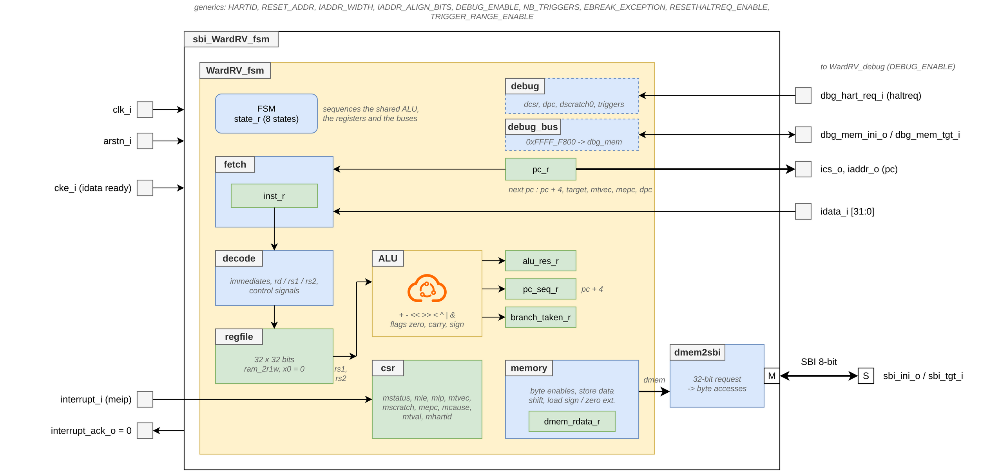
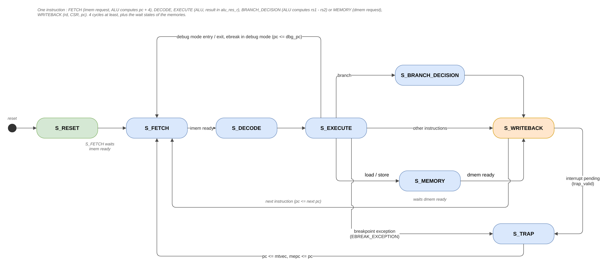

<!--
  README MODEL (common to every Asylum IP, keep the same headings)
  ----------------------------------------------------------------
  Regenerate from the sources, never from the previous README text alone:
    hdl/*.vhd (entities, generics, ports), <IP>.core (VLNV, targets, depends),
    mk/targets.txt, sim/, syn/, esw/.
  Sections, in this order (CPU variant: Instruction Set instead of Registers):
    badges / title + one-line pitch / Overview / Features / Block Diagram /
    Getting Started / Hardware Interfaces / Configuration / Resources /
    Theory of Operation / Instruction Set / Programmer's Guide /
    Design Verification / Dependencies and Related IPs / License
  Rules:
    - English, short and factual: every statement backed by the sources.
    - No VLNV line: the version badge shows it.
    - Badges: first line version, license; second line CI, lint, sim, syn;
      CPU: third line ISA extensions and debug, fourth line architecture
      test suites (groups of .github/badges.json).
    - Block diagram and FSM: pages Overview and FSM of doc/<NAME>.drawio, exported to
      doc/<NAME>-Overview.png and doc/<NAME>-FSM.png (make -C doc).
    - Tables: Configuration = Name|Type|Default|Description,
      Hardware Interfaces = Name|Direction|Type|Description, grouped by interface.
    - A section with nothing to say is one line, never removed.
-->
[](https://github.com/deuskane/asylum-processor-WardRV/tags)
[](LICENSE)

[](https://github.com/deuskane/asylum-processor-WardRV/actions/workflows/ci.yml)
[](https://github.com/deuskane/asylum-processor-WardRV/actions/workflows/ci.yml)
[](https://github.com/deuskane/asylum-processor-WardRV/actions/workflows/ci.yml)
[](https://github.com/deuskane/asylum-processor-WardRV/actions/workflows/ci.yml)

[](#instruction-set)
[](#instruction-set)
[](#traps-and-csrs)
[-blue)](#debug-unit)

[](#architecture-tests)
[](#architecture-tests)
[](#architecture-tests)

# WardRV

**A small, readable 32-bit RISC-V processor in VHDL: RV32I + Zicsr in machine mode, one multi-cycle FSM around a single shared ALU, an optional RISC-V Debug 1.0 unit for GDB + OpenOCD, verified with the RISC-V architecture tests.**

Part of the [Asylum project](https://github.com/deuskane/asylum-project), a collection of small IP cores, written to be read and learned from.

## Table of Contents

1. [Overview](#overview)
2. [Features](#features)
3. [Block Diagram](#block-diagram)
4. [Getting Started](#getting-started)
5. [Hardware Interfaces](#hardware-interfaces)
6. [Configuration](#configuration)
7. [Resources](#resources)
8. [Theory of Operation](#theory-of-operation)
9. [Instruction Set](#instruction-set)
10. [Programmer's Guide](#programmers-guide)
11. [Design Verification](#design-verification)
12. [Dependencies and Related IPs](#dependencies-and-related-ips)
13. [License](#license)

## Overview

WardRV is a RISC-V processor written for teaching and for the Asylum SoC ([PicoSoC](https://github.com/deuskane/asylum-soc-picosoc)). Its core, `WardRV_fsm`, executes one instruction at a time: a finite state machine walks each instruction through FETCH, DECODE, EXECUTE, (BRANCH_DECISION or MEMORY), WRITEBACK, and reuses one 32-bit ALU in every phase (pc + 4, the operation, the address, the branch comparison). Nothing is pipelined, so every signal of the datapath can be followed cycle by cycle.

- `sbi_WardRV_fsm` is the top level used in a SoC: an instruction port for a ROM and the 8-bit SBI bus (the simple bus of Asylum) for the data, through the `dmem2sbi` bridge. It has the same ports as the other Asylum CPU, so PicoSoC can select one or the other.
- `WardRV_debug` (optional) is a RISC-V debug unit (Debug Specification 1.0, JTAG transport): with it, GDB + OpenOCD can halt, step, read and write the registers and the memory, and set hardware breakpoints and watchpoints.
- `WardRV_iss` is a behavioural instruction-set simulator with the same instruction and data interfaces as the core.

## Features

- RV32I base instructions: LUI, AUIPC, JAL, JALR, BEQ / BNE / BLT / BGE / BLTU / BGEU, LB / LH / LW / LBU / LHU, SB / SH / SW, the arithmetic, logic, shift and compare instructions with a register or an immediate
- Zicsr: CSRRW / CSRRS / CSRRC and their immediate forms; MRET
- Machine mode: `mstatus`, `mie`, `mip`, `mtvec` (direct mode), `mscratch`, `mepc`, `mcause`, `mtval`, `mhartid`; machine external interrupt (`interrupt_i`)
- Multi-cycle FSM with one shared ALU, register file in a 2-read 1-write RAM (`ram_2r1w`), `x0` read as 0
- Byte, half-word and word loads and stores with sign / zero extension
- Configurable reset address and width / alignment of the instruction address
- Optional debug unit, every option a generic and off by default (the core is then unchanged): JTAG TAP and DTM, Debug Module (halt, resume, single step, abstract register access, program buffer, System Bus Access), triggers (hardware breakpoints / watchpoints, optionally address ranges), breakpoint exception, halt on reset
- Simulation only: execution trace (`exec_fsm.log`) and instruction statistics
- Verified with the RISC-V architecture tests (39 ACT3 tests with signature comparison, 45 self-checking ACT4 tests), a C test, an interrupt test, unit and system tests of the debug unit and an OpenOCD + GDB co-simulation

## Block Diagram



The FSM of the core (see [FSM](#fsm)):



## Getting Started

The cores of the Asylum IPs are published in the FuseSoC library [asylum-cores](https://github.com/deuskane/asylum-cores) (with the UVVM core used by the testbenches):

```bash
pip install fusesoc
fusesoc library add https://github.com/deuskane/asylum-cores
fusesoc run --target sim_basic asylum:processor:WardRV                  # C test program, needs GHDL
fusesoc run --target sim_compliance_act4_i_add_00 asylum:processor:WardRV
```

To use the processor in your design, add `asylum:processor:WardRV` to the `depend` list of your core and instantiate `sbi_WardRV_fsm` (library `asylum`), here with a ROM of 1024 words:

```vhdl
library asylum;
use     asylum.sbi_pkg.all;

  ins_cpu : entity asylum.sbi_WardRV_fsm
    generic map
    ( HARTID           => x"00000000"
     ,RESET_ADDR       => x"00000000"
     ,IADDR_WIDTH      => 10                -- 1024 instructions
     ,IADDR_ALIGN_BITS => 2                 -- word address
    )
    port map
    ( clk_i           => clk
     ,cke_i           => '1'
     ,arstn_i         => arst_b
     ,ics_o           => inst_cs
     ,iaddr_o         => inst_addr          -- (9 downto 0)
     ,idata_i         => inst_data          -- (31 downto 0), one cycle after ics_o
     ,sbi_ini_o       => sbi_ini            -- data bus, 8-bit
     ,sbi_tgt_i       => sbi_tgt
     ,interrupt_i     => it
     ,interrupt_ack_o => open
    );
```

The program comes from a ROM generated by the `rvcc_gen` generator of [asylum-utils-generators](https://github.com/deuskane/asylum-utils-generators): it compiles a C or assembly file with the RISC-V GCC toolchain (`RISCV_PREFIX`, default `riscv64-unknown-elf-`, `-march=rv32i_zicsr -mabi=ilp32`) and writes a ROM entity (default `WardRV_ROM`). In the core of your SoC:

```yaml
generate:
  gen_rom_user:
    generator : rvcc_gen
    parameters:
      file         : esw/main.c
      type         : c
      entity       : ROM_user
      logical_name : asylum
```

[PicoSoC](https://github.com/deuskane/asylum-soc-picosoc) is a complete example (`cpu_wrapper`, `CPU_MODEL = "WardRV_fsm"`, `IADDR_ALIGN_BITS = 2`, `rvcc_gen` ROMs). Without FuseSoC, [esw/testcase/Makefile](esw/testcase/Makefile) shows the same flow by hand (`start.S`, `main.c`, `link.ld` -> `.elf` -> `.hex`).

To add the debug unit, instantiate `WardRV_debug` next to the core: [syn/WardRV_wrapper.vhd](syn/WardRV_wrapper.vhd) connects it as in a SoC (see [Debug unit on a board](#debug-unit-on-a-board)).

## Hardware Interfaces

`sbi_WardRV_fsm` ([hdl/fsm/sbi_WardRV_fsm.vhd](hdl/fsm/sbi_WardRV_fsm.vhd)):

### Clock and Reset

| Name | Direction | Type | Description |
|------|-----------|------|-------------|
| `clk_i` | in | std_logic | Clock |
| `cke_i` | in | std_logic | Clock enable, only used to qualify the instruction ready (`ready = cke_i and ics_r`) |
| `arstn_i` | in | std_logic | Asynchronous reset, active low |

### Instruction

| Name | Direction | Type | Description |
|------|-----------|------|-------------|
| `ics_o` | out | std_logic | Instruction fetch request |
| `iaddr_o` | out | std_logic_vector(IADDR_WIDTH-1 downto 0) | Instruction address, `pc(IADDR_WIDTH-1+IADDR_ALIGN_BITS downto IADDR_ALIGN_BITS)` |
| `idata_i` | in | std_logic_vector(31 downto 0) | Instruction, sampled one cycle after `ics_o` (synchronous ROM) |

### Bus (SBI)

| Name | Direction | Type | Description |
|------|-----------|------|-------------|
| `sbi_ini_o` | out | sbi_ini_t | SBI request of `dmem2sbi`: one byte access per enabled byte (`cs`, `re`, `we`, `addr` = word address & byte index, 8-bit `wdata`) |
| `sbi_tgt_i` | in | sbi_tgt_t | SBI response (`ready`, 8-bit `rdata`) |

### Interrupt

| Name | Direction | Type | Description |
|------|-----------|------|-------------|
| `interrupt_i` | in | std_logic | Machine external interrupt request (`mip.MEIP`), a level |
| `interrupt_ack_o` | out | std_logic | Not implemented, tied to `'0'` |

### Debug (`DEBUG_ENABLE`)

| Name | Direction | Type | Description |
|------|-----------|------|-------------|
| `dbg_hart_req_i` | in | dbg_hart_req_t | Halt requests of `WardRV_debug` (`haltreq`, `resethaltreq`), default `DBG_HART_REQ_NULL` |
| `dbg_mem_ini_o` | out | dmem_ini_t | Accesses of the core to the debug memory (debug mode only) |
| `dbg_mem_tgt_i` | in | dmem_tgt_t | Debug memory response, default `DMEM_TGT_NULL` |

### WardRV_debug

`WardRV_debug` ([hdl/debug/WardRV_debug.vhd](hdl/debug/WardRV_debug.vhd)), the debug unit:

| Name | Direction | Type | Description |
|------|-----------|------|-------------|
| `jtag_ini_i` | in | jtag_ini_t | TCK, TMS, TDI, TRST* (TCK domain); record of `jtag_pkg` ([asylum-debug-jtag](https://github.com/deuskane/asylum-debug-jtag)) |
| `jtag_tgt_o` | out | jtag_tgt_t | TDO, `tdo_en` (TDO driven only in Shift-IR / Shift-DR); record of `jtag_pkg` |
| `clk_i` | in | std_logic | Clock of the core |
| `arst_b_i` | in | std_logic | Power-on reset of the debug unit (never `ndmreset_o`) |
| `hart_rst_b_i` | in | std_logic | Reset of the core (`dmstatus.havereset`, `unavail`) |
| `dbg_hart_req_o` | out | dbg_hart_req_t | To the core: `haltreq`, `resethaltreq` |
| `dbg_mem_ini_i` / `dbg_mem_tgt_o` | in / out | dmem_ini_t / dmem_tgt_t | Debug memory, from / to the core |
| `ndmreset_o` | out | std_logic | Reset request of the system (core and peripherals, not the debug unit) |
| `sba_dmem_ini_o` / `sba_dmem_tgt_i` | out / in | dmem_ini_t / dmem_tgt_t | System Bus Access, 32-bit requests with byte enables (`dmem2sbi` converts them for an SBI bus) |

## Configuration

`sbi_WardRV_fsm`:

| Name | Type | Default | Description |
|------|------|---------|-------------|
| `HARTID` | std_logic_vector(31 downto 0) | `(others => '0')` | Value of `mhartid` |
| `RESET_ADDR` | std_logic_vector(31 downto 0) | `(others => '0')` | pc after reset |
| `IADDR_WIDTH` | natural | `32` | Width of `iaddr_o` |
| `IADDR_ALIGN_BITS` | natural | `0` | pc LSBs dropped on `iaddr_o` (2 = word address); `IADDR_WIDTH + IADDR_ALIGN_BITS <= 32` |
| `DEBUG_ENABLE` | boolean | `false` | Debug mode and debug memory port, for `WardRV_debug` |
| `NB_TRIGGERS` | natural | `0` | Number of triggers (hardware breakpoints / watchpoints), needs `DEBUG_ENABLE` |
| `EBREAK_EXCEPTION` | boolean | `false` | `ebreak` (without `dcsr.ebreakm`) raises a breakpoint exception (`mcause = 3`) instead of being a NOP |
| `RESETHALTREQ_ENABLE` | boolean | `false` | Halt before the first instruction after reset on request of the debug unit |
| `TRIGGER_RANGE_ENABLE` | boolean | `false` | Triggers: match `>=` / `<` and `chain` (address ranges), needs `NB_TRIGGERS` |

`WardRV_fsm` also has `VERBOSE` (boolean, default `true`): simulation trace in `exec_fsm.log`; `sbi_WardRV_fsm` does not forward it.

`WardRV_debug`:

| Name | Type | Default | Description |
|------|------|---------|-------------|
| `IDCODE_VALUE` | std_logic_vector(31 downto 0) | `x"10000001"` | JTAG IDCODE (bit 0 = 1, manufacturer 0x7F forbidden: assertion) |
| `TRST_ENABLE` | boolean | `true` | Use TRST* |
| `DTM_IDLE_CYCLES` | natural | `5` | `dtmcs.idle`: Run-Test/Idle cycles advised to the debugger between two DMI scans |
| `PROGBUF_SIZE` | natural | `2` | Program buffer words (0 to 16; 0: register access only, `postexec` not supported); the word after the program buffer is always an `ebreak` (`impebreak`) |
| `DATA_COUNT` | positive | `2` | Data registers (1 to 12) |
| `SBA_ENABLE` | boolean | `false` | System Bus Access (memory access without the core, also while it runs) |
| `RESETHALTREQ_ENABLE` | boolean | `false` | `setresethaltreq` / `clrresethaltreq` (with the same generic in the core) |
| `AARPOSTINCREMENT_ENABLE` | boolean | `false` | `aarpostincrement` of the Access Register command (otherwise `cmderr` 2) |

## Resources

Figures of the `syn_*` targets (`make nonreg_syn`, see [Targets](#targets)): [syn/WardRV_wrapper.vhd](syn/WardRV_wrapper.vhd) (`sbi_WardRV_fsm` with flat ports, word address of the 32-bit space, and `WardRV_debug` with `DEBUG_ENABLE`) with the generics of each configuration, synthesized by Yosys and its GHDL plugin; the reports are in the build directory of each target.

| Configuration | LUT¹ | LUTRAM¹ | FF¹ | CARRY4¹ | MUXF7/F8¹ | BRAM¹ | DSP¹ | Area² (µm²) | kGE³ |
|---|---|---|---|---|---|---|---|---|---|
| `syn_default` (core, no debug unit) | 985 | 48 | 325 | 13 | 152 | 0 | 0 | 66461.24 | 17.706 |
| `syn_debug` (debug unit: program buffer 2, 2 data, no trigger, no SBA) | 1890 | 48 | 780 | 20 | 184 | 0 | 0 | 90106.42 | 24.005 |
| `syn_debug_max` (program buffer 16, 12 data, 8 triggers with ranges, SBA, every option) | 4417 | 48 | 2022 | 133 | 598 | 0 | 0 | 163754.55 | 43.626 |

¹ Xilinx Artix-7 (LUT6), Yosys 0.33 `synth_xilinx -flatten -noiopad -noclkbuf`, before place and route: every cell of the netlist is counted, Vivado may differ. Identical cells are merged as a vendor tool does (`opt_merge -share_all`): the inverters of an active-low reset net become one; every remaining cell is counted, an `INV` as a `LUT1`. The register file (`ram_2r1w`, 32 x 32 bits, asynchronous read) is in LUTRAM, not in BRAM.

² SkyWater sky130 `sky130_fd_sc_hd`, typical corner (tt, 25 °C, 1.80 V), Yosys 0.33 `synth` + `dfflibmap` + `abc -liberty`: standard-cell area only, no timing constraint, no buffering, clock tree or placement; the register file becomes flip-flops (no SRAM macro).

³ Area in thousands of NAND2 gate equivalents (`sky130_fd_sc_hd__nand2_1` = 3.7536 µm²).

In `syn_default`, 15 of the 985 LUTs are `INV`. For comparison, [PicoRV32](https://github.com/YosysHQ/picorv32) in the small configuration of its README (`top_small` of `scripts/vivado/synth_area_top.v`: no counters, no IRQ, synchronous reset, native 32-bit memory interface) gives in the same flow 936 LUT (39 `INV`), 48 LUTRAM, 437 FF, 62 CARRY4, 24 MUXF7/F8, 68831 µm², 18.337 kGE.

## Theory of Operation

### Hierarchy

| File | Unit | Role |
|------|------|------|
| [hdl/fsm/sbi_WardRV_fsm.vhd](hdl/fsm/sbi_WardRV_fsm.vhd) | `sbi_WardRV_fsm` | Top level: `WardRV_fsm` + `dmem2sbi`, instruction port for a synchronous ROM |
| [hdl/fsm/WardRV_fsm.vhd](hdl/fsm/WardRV_fsm.vhd) | `WardRV_fsm` | The core: FSM, pc, datapath multiplexers, instances below |
| [hdl/fsm/WardRV_fsm_fetch.vhd](hdl/fsm/WardRV_fsm_fetch.vhd) | `WardRV_fsm_fetch` | Instruction request (`imem`) and instruction register `inst_r` |
| [hdl/fsm/WardRV_fsm_decode.vhd](hdl/fsm/WardRV_fsm_decode.vhd) | `WardRV_fsm_decode` | Combinational decoder: the immediate of the instruction, register addresses, control signals |
| [hdl/fsm/WardRV_fsm_regfile.vhd](hdl/fsm/WardRV_fsm_regfile.vhd) | `WardRV_fsm_regfile` | 32 x 32-bit register file (`ram_2r1w`), reads of `x0` return 0 |
| [hdl/fsm/WardRV_fsm_alu.vhd](hdl/fsm/WardRV_fsm_alu.vhd) | `WardRV_fsm_alu` | 32-bit ALU (ADD, SUB, SLL, SLT, SLTU, XOR, SRL, SRA, OR, AND, CLR) with zero, borrow and signed less-than flags: one adder, one shifter |
| [hdl/fsm/WardRV_fsm_memory.vhd](hdl/fsm/WardRV_fsm_memory.vhd) | `WardRV_fsm_memory` | Data request (`dmem`): byte enables and store data shifted by `addr(1:0)`, load data shifted back, sign / zero extended, registered |
| [hdl/fsm/WardRV_fsm_csr.vhd](hdl/fsm/WardRV_fsm_csr.vhd) | `WardRV_fsm_csr` | Machine CSRs (only their implemented bits), trap entry, MRET, interrupt request |
| [hdl/fsm/WardRV_fsm_debug.vhd](hdl/fsm/WardRV_fsm_debug.vhd), [WardRV_fsm_trigger.vhd](hdl/fsm/WardRV_fsm_trigger.vhd), [WardRV_fsm_debug_bus.vhd](hdl/fsm/WardRV_fsm_debug_bus.vhd) | `WardRV_fsm_debug`, `_trigger`, `_debug_bus` | Debug support of the core (`DEBUG_ENABLE`), see [Debug unit](#debug-unit) |
| [hdl/bridge/dmem2sbi.vhd](hdl/bridge/dmem2sbi.vhd) | `dmem2sbi` | 32-bit `dmem` request to 8-bit SBI accesses (one per enabled byte) |
| [hdl/bridge/imem2sbi.vhd](hdl/bridge/imem2sbi.vhd) | `imem2sbi` | 32-bit `imem` request to four 8-bit SBI reads (not instantiated in this repository) |
| [hdl/debug/WardRV_debug.vhd](hdl/debug/WardRV_debug.vhd) | `WardRV_debug` | Debug unit: `WardRV_dbg_jtag` (TAP `jtag_tap` of [asylum-debug-jtag](https://github.com/deuskane/asylum-debug-jtag), DTM, DMI CDC) + `WardRV_dbg_dm` (Debug Module, debug memory, System Bus Access) |
| [hdl/iss/WardRV_iss.vhd](hdl/iss/WardRV_iss.vhd), [WardRV_iss_pkg.vhd](hdl/iss/WardRV_iss_pkg.vhd) | `WardRV_iss` | Behavioural instruction-set simulator (simulation only) |
| [hdl/RV_pkg.vhd](hdl/RV_pkg.vhd), [WardRV_pkg.vhd](hdl/WardRV_pkg.vhd), [WardRV_stats_pkg.vhd](hdl/WardRV_stats_pkg.vhd), [fsm/WardRV_decode_pkg.vhd](hdl/fsm/WardRV_decode_pkg.vhd), [debug/WardRV_debug_pkg.vhd](hdl/debug/WardRV_debug_pkg.vhd) | packages | RISC-V encodings and CSR addresses, interface records (`imem`, `dmem`; the JTAG records are in `jtag_pkg` of asylum-debug-jtag) and their majority vote (below), trace and statistics, decoder selections, debug constants and records |

`WardRV_pkg` gives the majority vote of three copies of each interface record, for a triple modular redundancy (TMR) of the core (three cores in lockstep, e.g. the safety CPU of PicoSoC): `vote(i0, i1, i2)` for `imem_ini_t`, `imem_tgt_t`, `dmem_ini_t` and `dmem_tgt_t`, each bit of each field takes the value of at least two copies. Each field is voted by the TMR decoder of `ft_pkg` ([asylum-utils-pkg](https://github.com/deuskane/asylum-utils-pkg)): `decode(i2.<field> & i1.<field> & i0.<field>, FT_TMR).data`, a `std_logic` field as a vector of 1 bit.

### FSM

| State | Action | Next |
|-------|--------|------|
| `S_RESET` | - | `S_FETCH` (debug: halt on reset request) |
| `S_FETCH` | `imem` request at `pc`; the ALU computes `pc + 4` (kept in `pc_seq_r`) | `S_DECODE` when the instruction is ready |
| `S_DECODE` | The decoder reads `inst_r` (combinational) | `S_EXECUTE` |
| `S_EXECUTE` | The ALU executes the instruction, result kept in `alu_res_r` (value, address, jump or branch target) | `S_BRANCH_DECISION` (branch), `S_MEMORY` (load / store), else `S_WRITEBACK`; debug: `S_TRAP` on a breakpoint exception, `S_FETCH` on a debug mode entry / exit (the instruction is abandoned) |
| `S_BRANCH_DECISION` | The ALU computes `rs1 - rs2`, the branch condition is kept (BEQ / BNE: zero, BLT / BGE: signed less-than `N xor V`, BLTU / BGEU: borrow) | `S_WRITEBACK` |
| `S_MEMORY` | `dmem` request at `alu_res_r` | `S_WRITEBACK` when the data is ready |
| `S_WRITEBACK` | Register write (ALU, memory, `pc + 4` or CSR), CSR write, pc update | `S_TRAP` if an interrupt is pending, else `S_FETCH` |
| `S_TRAP` | `pc <= mtvec`, `mepc <= pc` (the next instruction), `mcause`, `mstatus` updated | `S_FETCH` |

Next pc: `mtvec` on a trap, `mepc` on MRET, `alu_res_r` with bits 1..0 cleared for JAL / JALR / a taken branch, else `pc + 4`.

Cycles per instruction: FETCH lasts until the instruction is ready, 2 cycles in `sbi_WardRV_fsm` (and in the testbench): the request, then the instruction one cycle later. DECODE, EXECUTE, BRANCH_DECISION and WRITEBACK take one cycle each, so an ALU, jump or CSR instruction takes 5 cycles and a branch 6. MEMORY lasts the data access: in `sbi_WardRV_fsm`, `dmem2sbi` captures the request, makes one step per byte lane (an enabled lane waits for the SBI `ready`, a disabled one is skipped) and answers in a last cycle.

### Datapath

The ALU sources are chosen by the FSM state: `pc` and 4 in FETCH, `rs1` and `rs2` in BRANCH_DECISION, the selections of the decoder otherwise (`rs1`, `pc` or the CSR immediate; `rs2`, the immediate of the instruction or the CSR value). The decoder selects the immediate by the format of the instruction (I, S, B, U or J), so the ALU sees one immediate. The register file is read asynchronously, written in WRITEBACK. CSRRC / CSRRCI use the ALU operation CLR (`csr and not rs1`), CSRRS / CSRRSI an OR.

The ALU has one adder and one shifter, shared by the operations:

- ADD, SUB, SLT and SLTU use the adder: `src_a - src_b = src_a + not src_b + 1`. Unsigned less-than (SLTU, BLTU / BGEU) is the borrow (no carry out of the subtraction); signed less-than (SLT, BLT / BGE) is the sign of `src_a` when the signs differ (the difference may overflow), else the sign of the difference.
- SLL, SRL and SRA use one 33-bit arithmetic right shift of `fill & operand`: the fill bit is the sign of `src_a` for SRA and 0 for SRL; SLL shifts the bit-reversed operand and reverses the result (`a << n = reverse(reverse(a) >> n)`).

### Traps and CSRs

- The only trap without the debug options is the machine external interrupt: `interrupt_i` is registered in `mip.MEIP`; the trap is taken at the end of WRITEBACK when `mip.MEIP`, `mie.MEIE` and `mstatus.MIE` are set. The enables written by the instruction itself count at once: no trap after the instruction that clears `MIE` / `MEIE`, a trap right after the one that sets them while the interrupt is pending.
- Trap entry: `mepc` = pc of the next instruction, `mcause = 0x8000000B`, `MPIE <= MIE`, `MIE <= 0`, `pc <= mtvec` (direct mode: `mtvec.MODE` reads 0).
- The CSRs keep only their implemented bits; the other bits read 0 and ignore writes (WARL): `mstatus` = MIE, MPIE and MPP read-only 3 (machine mode only), `mie` = MEIE, `mip` = MEIP, `mcause` = Interrupt and the Exception Code (bits 4..0, WLRL: holds 0 to 31), `mtval` read-only 0 (no trap writes a non-zero value). For example `csrw mstatus, -1` reads back `0x00001888`.
- MRET (applied once, in WRITEBACK): `MIE <= MPIE`, `MPIE <= 1`, `pc <= mepc`.
- With `EBREAK_EXCEPTION`, `ebreak` (without `dcsr.ebreakm`) and a trigger of M-mode trap from EXECUTE: `mcause = 3`, `mepc` = address of the instruction.
- Not implemented: exceptions for illegal instructions, ECALL or misaligned accesses. Unknown instructions, FENCE, ECALL, WFI, EBREAK (without `EBREAK_EXCEPTION` nor `dcsr.ebreakm`) and DRET outside debug mode execute as NOPs.

### Debug unit

RISC-V Debug Specification 1.0, execution-based (the core executes the debug code itself), for GDB + OpenOCD on the JTAG port. Two parts, both optional:

- in the core (`DEBUG_ENABLE`): debug mode and the debug CSRs (`WardRV_fsm_debug`), triggers (`WardRV_fsm_trigger`, `NB_TRIGGERS`), the debug memory window (`WardRV_fsm_debug_bus`), breakpoint exception (`EBREAK_EXCEPTION`), halt on reset (`RESETHALTREQ_ENABLE`);
- outside the core, `WardRV_debug`: JTAG transport and Debug Module.

```
            TCK domain                     |                 clk domain
 JTAG   +-------------+  user  +-----------+  dmi_req   +----------------------+
 pins ->| jtag_tap    |  DR    | dbg_dtm + |----------->| WardRV_dbg_dm        |--> ndmreset_o (reset of the system)
        | (1149.1)    |<------>| dmi_cdc   |<-----------| dbg_dm_mem, dbg_sba  |--> sba_dmem   (System Bus Access)
        +-------------+        +-----------+  dmi_rdata +----------------------+
         WardRV_dbg_jtag                                   | dbg_hart_req   ^ dbg_mem (debug memory, 0xFFFF_F800)
                                                           v                |
                                                  +----------------------------------+
                                                  | WardRV_fsm                       |
                                                  |   WardRV_fsm_debug (+ _trigger)  |
                                                  |   WardRV_fsm_debug_bus           |
                                                  +----------------------------------+
```

The TAP is `jtag_tap` of [asylum-debug-jtag](https://github.com/deuskane/asylum-debug-jtag) (IEEE 1149.1, IR of `JTAG_IR_WIDTH` = 5 bits, IDCODE `00001` selected after reset, BYPASS). `WardRV_dbg_dtm` decodes its two user instructions, DTMCS (`10000`) and DMI (`10001`), next to their data registers: its `tdo_en_o`, wired by `WardRV_dbg_jtag` to `user_tdo_en_i` of the TAP, selects its TDO; every other opcode is BYPASS.

How a debugger uses it:

1. **Halt**: the Debug Module raises `haltreq`. At the end of the current instruction the core enters debug mode: `dpc` = next pc, `dcsr.cause` = 3, pc = `0xFFFF_F800`, the debug ROM. The ROM saves `s0` in `dscratch0`, writes HALTED (`dmstatus.allhalted` = 1) and waits for GO or RESUME.
2. **Register access** (abstract command): the Debug Module writes a small program (for example `sw x5, data0(zero)` to read `x5`) and sets GO. The ROM jumps to it; the program ends with an `ebreak`, back to the ROM, and HALTED ends the command. With `postexec` the program runs on into the program buffer (instructions written by the debugger, for example a memory access), which also ends with an `ebreak`.
3. **Resume**: the Debug Module sets RESUME, the ROM writes RESUMING (`dmstatus.allresumeack`) and executes `dret`: pc = `dpc`, debug mode left.

Debug mode entries of the core:

| Entry | `dcsr.cause` | When | `dpc` |
|-------|--------------|------|-------|
| trigger with `dmode` = 1 | 2 | EXECUTE, the instruction is abandoned | pc |
| `ebreak` with `dcsr.ebreakm` | 1 | EXECUTE, the instruction is abandoned | pc |
| `resethaltreq` / `haltreq` at reset | 5 / 3 | RESET, before the first instruction | `RESET_ADDR` |
| `haltreq` | 3 | end of WRITEBACK, or TRAP when an interrupt is taken | next pc (`mtvec` in TRAP) |
| step (`dcsr.step`) | 4 | same, one instruction after `dret` | next pc |

In debug mode interrupts are masked (also during a step when `dcsr.stepie` = 0), triggers do not fire, `ebreak` goes back to the ROM and `dret` leaves at `dpc`; the core raises no exception, so the ROM has no exception entry.

Triggers (Sdtrig, type mcontrol6): match on the address of the instruction (execute) or of a load / store, timing before, M-mode. The match is "equal"; with `TRIGGER_RANGE_ENABLE` also `>=` (2) and `<` (3) and `chain`: a chain fires only when all its triggers match, so two chained triggers `>= A` and `< B` stop on the range [A, B). `action` = `dmode`: a trigger of the debugger (`dmode` = 1, writable in debug mode only) enters debug mode, a trigger of M-mode software (`dmode` = 0) raises a breakpoint exception and can only fire with `EBREAK_EXCEPTION`. `tinfo` = `0x01000040`.

Debug Module: `data0..`, `dmcontrol`, `dmstatus`, `hartinfo`, `abstractcs`, `command`, `abstractauto`, `progbuf0..`, `sbcs` / `sbaddress0` / `sbdata0`, `haltsum0`. Access Register commands (`aarsize` 2) of the GPRs (`0x1000-0x101F`) and CSRs (`0x0000-0x0FFF`); `cmderr` 2 for another command type, `aarsize`, `aarpostincrement` without `AARPOSTINCREMENT_ENABLE` or `postexec` without program buffer, 3 for a register that does not exist, 4 if the core is not halted, 1 for an access during a command. The DTM sets a sticky busy status when the debugger scans again before the end of a request (cleared by `dmireset`); the DMI crosses from TCK to `clk` with a 4-phase handshake (`sync2dffrn`).

Debug memory, 2 KB at `0xFFFF_F800`, seen by the core in debug mode only:

| Offset | Content | Core access |
|--------|---------|-------------|
| `0x000` | Debug ROM ([esw/debug_rom/debug_rom.S](esw/debug_rom/debug_rom.S)), halt entry | R |
| `0x100` / `0x104` | HALTED / RESUMING | W |
| `0x108` / `0x10C` | GO / RESUME flags | R |
| `0x200` | Abstract command program (5 words) | R |
| `0x214` | Program buffer (`PROGBUF_SIZE` words), then `ebreak` | R |
| `0x300` | Data registers (`DATA_COUNT` words) | R/W |

The ROM package [hdl/debug/WardRV_dbg_rom_pkg.vhd](hdl/debug/WardRV_dbg_rom_pkg.vhd) is generated by `make` in `esw/debug_rom` (RISC-V toolchain, then `rom_pkg.awk`); the `.hex`, `.lst` and the package are committed.

What GDB + OpenOCD can do in each configuration (checked by the `sim_dbg_openocd_*` co-simulations, OpenOCD 0.12.0, GDB 15.1):

| Program buffer | SBA | Triggers | Memory, core halted | Memory, core running | `break` | `hbreak` / `watch` | `stepi` / `next` | Halt, resume, registers, `monitor step` |
|---|---|---|---|---|---|---|---|---|
| 0 | no | 0 | no (error) | no | no (error) | no (error) | no (GDB steps in software, it reads the instruction) | yes |
| 0 | no | 2 | no (error) | no | no (error) | `hbreak` yes; `watch` stops the core but GDB sees a SIGTRAP | no | yes |
| 0 | yes | 0 / 2 | yes (System Bus Access) | yes | yes | yes with triggers, else refused | yes | yes |
| 2 | no | 0 / 2 | yes (program buffer) | no (error) | yes | yes with triggers, else refused | yes | yes |
| 2 | yes | 0 / 2 | yes (both) | yes (SBA) | yes | yes with triggers, else refused | yes | yes |
| 16, 12 data, `aarpostincrement` | yes | 8 with ranges | yes (both) | yes (SBA) | yes | yes, several together | yes | yes |

OpenOCD 0.12 uses neither `aarpostincrement` nor the range triggers: the co-simulation only checks that they do not disturb it.

### Debug unit on a board

1. Integration in the SoC (as [syn/WardRV_wrapper.vhd](syn/WardRV_wrapper.vhd) with `DEBUG_ENABLE = true`): `sbi_WardRV_fsm` with `DEBUG_ENABLE` (and `NB_TRIGGERS`, ...) and `WardRV_debug` on the same `clk_i`, `dbg_hart_req`, `dbg_mem_ini`, `dbg_mem_tgt` connected; `arst_b_i` of `WardRV_debug` = power-on reset; the core and the peripherals reset by the power-on reset or `ndmreset_o`, also on `hart_rst_b_i`; JTAG on 4 (5 with TRST*) pins, pull-ups on TMS, TDI and TRST*, TDO tri-stated by `tdo_en`; TCK is a clock (its own constraint, the CDC paths are false paths or quasi-static); with `SBA_ENABLE`, `sba_dmem` through a `dmem2sbi` to an extra master port of the interconnect.
2. OpenOCD: take [sim/openocd/wardrv.cfg](sim/openocd/wardrv.cfg), replace the `remote_bitbang` lines by the JTAG probe (for example `adapter driver ftdi`) and an `adapter speed`, set `-expected-id` to `IDCODE_VALUE`. If TCK is fast compared to `clk_i`, raise `DTM_IDLE_CYCLES` (OpenOCD also retries on busy).
3. GDB: `gdb-multiarch firmware.elf`, `target extended-remote localhost:3333`, `monitor reset halt`, `load`, `break main`, `continue`, `hbreak`, `watch`, `x`, `set var`, `monitor step`.

## Instruction Set

RV32I (unprivileged ISA 2.1) and Zicsr (2.0) in machine mode, IALIGN = 32:

| Group | Instructions |
|-------|--------------|
| Upper immediates | LUI, AUIPC |
| Jumps | JAL, JALR (target bits 1..0 cleared) |
| Branches | BEQ, BNE, BLT, BGE, BLTU, BGEU |
| Loads / stores | LB, LH, LW, LBU, LHU, SB, SH, SW |
| Register-immediate | ADDI, SLTI, SLTIU, XORI, ORI, ANDI, SLLI, SRLI, SRAI |
| Register-register | ADD, SUB, SLL, SLT, SLTU, XOR, SRL, SRA, OR, AND |
| Zicsr | CSRRW, CSRRS, CSRRC, CSRRWI, CSRRSI, CSRRCI |
| Privileged | MRET; DRET and EBREAK with the debug unit; FENCE, ECALL, WFI execute as NOPs |

Machine CSRs (every other CSR address reads 0 and ignores writes; in each CSR, the bits not listed read 0 and ignore writes):

| CSR | Address | Reset | Notes |
|-----|---------|-------|-------|
| `mstatus` | `0x300` | `0x00001800` | MIE (bit 3), MPIE (bit 7), updated on trap and MRET; MPP (bits 12..11) read-only 11 |
| `mie` | `0x304` | `0` | MEIE (bit 11) enables the external interrupt, the only bit |
| `mtvec` | `0x305` | `0` | Trap address, MODE (bits 1..0) read-only 0 (direct mode only) |
| `mscratch` | `0x340` | `0` | Scratch |
| `mepc` | `0x341` | `0` | Return address of MRET, bits 1..0 read-only 0 |
| `mcause` | `0x342` | `0` | Interrupt (bit 31) and Exception Code (bits 4..0, WLRL); `0x8000000B` on the external interrupt, 3 on a breakpoint exception |
| `mtval` | `0x343` | `0` | Read-only 0 |
| `mip` | `0x344` | `0` | MEIP (bit 11) = `interrupt_i` (registered), read-only |
| `mhartid` | `0xF14` | `HARTID` | Read-only |

Debug CSRs (`DEBUG_ENABLE`, in debug mode only, otherwise read 0): `dcsr` (`0x7B0`, reset `0x40000003`: debugver 4, `ebreakm` (15), `stepie` (11), `cause` (8:6), `step` (2), prv 3), `dpc` (`0x7B1`), `dscratch0` (`0x7B2`). Trigger CSRs (`NB_TRIGGERS` > 0, also in M-mode): `tselect` (`0x7A0`), `tdata1` (`0x7A1`, mcontrol6, reset `0x60000000`), `tdata2` (`0x7A2`), `tdata3` (`0x7A3`, 0), `tinfo` (`0x7A4`).

## Programmer's Guide

Build programs with `-march=rv32i_zicsr -mabi=ilp32` (no M, no C extension), freestanding, with a `start.S` that sets the stack pointer and a `link.ld` for the memory map of the SoC (examples: [esw/testcase/](esw/testcase/), the templates of `rvcc_gen`). The data accesses of `sbi_WardRV_fsm` go to the SBI bus, byte by byte: software sees the registers of the Asylum peripherals at their SBI addresses.

### Example: count external interrupts

```c
#include <stdint.h>

// Machine CSRs of WardRV (mstatus.MIE = bit 3, mie.MEIE = bit 11)
#define MSTATUS_MIE  (1u << 3)
#define MIE_MEIE     (1u << 11)

#define csr_read(csr)       ({ uint32_t v; __asm__ volatile ("csrr %0, " #csr : "=r"(v)); v; })
#define csr_write(csr, v)   __asm__ volatile ("csrw " #csr ", %0" :: "r"(v))
#define csr_set(csr, v)     __asm__ volatile ("csrs " #csr ", %0" :: "r"(v))
#define csr_clear(csr, v)   __asm__ volatile ("csrc " #csr ", %0" :: "r"(v))

volatile uint32_t nb_irq;

// Trap handler : the only trap without EBREAK_EXCEPTION is the external
// interrupt (mcause = 0x8000000B). The source (meip_i) must be cleared here,
// for example in the interrupt controller, before mret.
__attribute__((interrupt("machine"), aligned(4)))
void trap_handler(void)
{
  if (csr_read(mcause) == 0x8000000Bu)
    nb_irq++;
}

int main(void)
{
  csr_write(mtvec, (uint32_t)&trap_handler);  // direct mode (MODE is read-only 0)
  csr_set  (mie,     MIE_MEIE);               // enable the external interrupt
  csr_set  (mstatus, MSTATUS_MIE);            // enable the interrupts

  while (nb_irq < 3)
    ;

  csr_clear(mstatus, MSTATUS_MIE);
  return 0;
}
```

Compiles with `riscv64-unknown-elf-gcc -march=rv32i_zicsr -mabi=ilp32 -O2 -ffreestanding -Wall -Wextra -c` (toolchain of the asylum-env image). `interrupt_i` is a level: the handler must clear the source before `mret`, else the trap is taken again at once. [esw/irq/irq.S](esw/irq/irq.S) shows the same in assembly, with the corner cases of the interrupt enables.

## Design Verification

### Testbenches

| Directory | DUT | Description |
|-----------|-----|-------------|
| [sim/wardrv/](sim/wardrv/) | `WardRV_fsm` (`MODEL = "FSM"`, default) or `WardRV_iss` (`MODEL = "ISS"`) | `tb_WardRV` runs a firmware (`FIRMWARE_FILE`, hex) from a memory answering one cycle after each request. `TEST_ENV = "ACT3"` (default): memory at `0x80000000`, the program writes `tohost` (`0x80200000`): 1 = TEST PASSED; with `SIGNATURE_FILE` and `GOLDEN_FILE`, the signature area is dumped and compared word by word with the reference (`TB_ERROR` on the first mismatch); timeout 500 µs. `TEST_ENV = "ACT4"`: 512 KB at `0x00004000`, console at `0x10000000`, PASS / FAIL written at `0x20000000`; timeout 10 ms. A store at `0x80300000` drives `meip_i` from the next instruction fetch. `tb_WardRV_iss` drives the ISS protected type from a process (no target) |
| [sim/dbg_jtag/](sim/dbg_jtag/) | `WardRV_dbg_jtag` | JTAG BFM, fake Debug Module (128 registers), monitors of TDO (changes on the falling edge of TCK only) and of the Capture-IR value, clk period `CLK_PERIOD_NS` |
| [sim/dbg_dm/](sim/dbg_dm/) | `WardRV_dbg_dm` (SBA, `PROGBUF_SIZE` 2 or 0, `AARPOSTINCREMENT_ENABLE`) | The sequencer is the debugger (DMI) and the hart (debug memory accesses, abstract programs checked against the GNU as encodings); SBA memory with a wait state |
| [sim/dbg_system/](sim/dbg_system/) | `WardRV_fsm` (2 triggers) + `WardRV_debug` | System test: a debugger on the JTAG port, the core runs [esw/debug/debug_fw.S](esw/debug/debug_fw.S) (loaded again by each reset pulse) |
| [sim/openocd/](sim/openocd/) | `WardRV_fsm` + `WardRV_debug` | OpenOCD + GDB co-simulation, see below |
| [sim/pkg/](sim/pkg/) | functions of `WardRV_pkg` | `tb_pkg`, no DUT, scenarios chosen by `TESTS_LIST`: `vote` (96 checks), two values with every bit of every field different, the three copies equal then each copy in turn different from the two others in every field, for both values: the 8 cases of a majority of three bits on every bit of every field of the four records |
| [sim/bridge/](sim/bridge/) | `imem2sbi` + `sbi_ram` | Two instances (`sbi_ram` with asynchronous and synchronous read): the RAM is filled through SBI, then the bridge fetches aligned, unaligned and out-of-range words; `cs` of the bridge must equal `re` |

The JTAG testbenches drive the debug unit with the JTAG BFM `jtag_bfm_pkg` of [asylum-verification-uvvm](https://github.com/deuskane/asylum-verification-uvvm) (TDO tri-stated by `tdo_en`, as at the pad): TRST* pulse alone (`jtag_trst`), scans, and the monitor `jtag_ir_capture_monitor`, which checks the full Capture-IR value `00001` of every IR scan (`jtag_write_ir` checks its two LSBs `01`). Shared code in [sim/common/](sim/common/): `WardRV_vips` (reset pulses; the configuration of the JTAG BFM, TCK 50 ns and 5-bit IR, without TRST* for `jtag_reset` by TMS only and with TRST* for `jtag_trst`; the DTM procedures with the busy retry of a debugger, nothing of the JTAG protocol itself) and `tb_WardRV_pkg` (memory model, hex loading, signature dump and comparison).

### Architecture tests

The RISC-V architecture tests ([riscv-arch-test](https://github.com/riscv/riscv-arch-test)), one `sim_compliance_*` target and one CI job per test, all passing:

| Suite | Targets | Tests | Check |
|-------|---------|-------|-------|
| ACT3 RV32I (riscv-arch-test 3.10.0, `rv32i_m/I`) | `sim_compliance_act3_<test>` | 39 | `tohost = 1` and signature identical to the Sail reference model |
| ACT4 RV32I (riscv-arch-test 4.1.0) | `sim_compliance_act4_i_<instruction>_00` | 39 | self-checking program, PASS written at `0x20000000` |
| ACT4 Zicsr (riscv-arch-test 4.1.0) | `sim_compliance_act4_zicsr_<instruction>_00` | 6 | self-checking program |

The programs and reference signatures are committed in `esw/compliance_act3/benchs` and `esw/compliance_act4/benchs`: a simulation needs neither a toolchain nor Sail. `make full` in [esw/compliance_act3](esw/compliance_act3/) or [esw/compliance_act4](esw/compliance_act4/) downloads the pinned tools (xPack GCC, Sail 0.13.1, riscv-arch-test) and rebuilds them, byte identical; their `docker/` directory builds an Ubuntu 24.04 image with these tools for a generation without network.

### Firmware tests

| Target | Firmware | Description |
|--------|----------|-------------|
| `sim_basic` | [esw/testcase/](esw/testcase/) (`start.S`, `main.c`) | Arithmetic, shifts, comparisons, immediates, loads / stores of every width in C, `tohost` = 1 or the failing check |
| `sim_irq` | [esw/irq/irq.S](esw/irq/irq.S) | `meip_i` pending during `csrci mstatus` / `csrc mie` (no trap) and during `csrsi mstatus` / `csrs mie` (trap right after: `mepc`, `mcause`, `mstatus.MPIE`), `mtvec.MODE` read back as 0, `mret` with `MPIE = 0`, `mstatus` / `mie` / `mtval` written with all ones read back only their implemented bits |

The firmwares are built by the `Makefile` of their directory with the RISC-V toolchain; the `.hex` / `.lst` are committed.

### Scenarios of the debug testbenches (`TESTS_LIST`)

The scenarios are chosen at run time with the generic `TESTS_LIST`: names separated by `,` without space, a name may be repeated. The sequencer first checks every name (an unknown name, or a scenario that does not apply to the generics, is a `TB_ERROR` before any scenario runs), then for each scenario drives a reset pulse (and TRST*), logs `TEST <i>/<N> : <name>` and runs it: each scenario starts from reset. The empty list (default) only compiles and elaborates the testbench. One package per scenario (`<tb>_<name>_pkg`), shared helpers in `<tb>_bfm_pkg`, names and dispatch in `<tb>_tests_pkg`. Checks are the `=> OK` lines of the log of each scenario.

`tb_WardRV_dbg_jtag` (`sim_dbg_jtag_<name>`, clk 10 ns, TCK 50 ns):

| Name | Checks | Description |
|------|--------|-------------|
| `reset` | 3 | After TRST*: IDCODE selected, `dtmcs` (idle 5, abits 7, version 1) |
| `tap` | 9 | Test-Logic-Reset (TRST*, 5 x TMS = 1), Capture-IR, IDCODE, BYPASS and undecoded opcodes |
| `dmi` | 25 | DMI writes and reads of the fake Debug Module through the CDC, one DMI request per access |
| `busy` | 24 | Scans too close to each other: sticky busy status, request ignored, `dmireset` and `dmihardreset` |

`sim_dbg_jtag_slow_dmi` runs `dmi` with a clk 40 times slower than TCK (busy retries, requests at the end of the handshake): 101 checks (the number of retries depends on the clock phase).

`tb_WardRV_dbg_dm` (`sim_dbg_dm_<name>`, program buffer of 2 words):

| Name | Checks | Description |
|------|--------|-------------|
| `reset` | 7 | After reset: `dmcontrol`, `dmstatus`, `abstractcs`, `sbcs`, `hartinfo`, `haltsum0` |
| `dmcontrol` | 12 | `dmactive`, `ackhavereset`, `ndmreset`, `dmactive` = 0 resets the Debug Module |
| `halt_resume` | 20 | `haltreq`, HALTED, `resumereq`, RESUMING, `resumeack` |
| `abstract` | 100 | Programs of GPR / CSR reads and writes, `postexec` and the program buffer with its implicit `ebreak`, data registers |
| `cmderr` | 31 | `cmderr`: not supported, exception, halt / resume, busy, W1C |
| `autoexec` | 68 | `abstractauto` on data and program buffer accesses |
| `resethaltreq` | 7 | `setresethaltreq` / `clrresethaltreq`, hart reset (`havereset`, `unavail`) |
| `sba` | 29 | System Bus Access 8 / 16 / 32 bits, autoincrement, `sbreadonaddr`, `sbreadondata`, `sberror`, `sbbusyerror` |
| `progbuf0` | 25 | Configuration `sim_dbg_dm_progbuf0` (`PROGBUF_SIZE = 0`): `progbufsize` 0, `postexec` not supported, register access |
| `postincrement` | 86 | Configuration `sim_dbg_dm_postincrement` (`AARPOSTINCREMENT_ENABLE`): `aarpostincrement` with `abstractauto` |

`tb_WardRV_debug` (`sim_dbg_system_<name>`, system test):

| Name | Checks | Description |
|------|--------|-------------|
| `reset` | 13 | After reset the core runs its firmware (`allrunning`, counter in memory), Debug Module idle |
| `halt_resume` | 96 | `haltreq` (cause 3, `dpc` in the loop), resume; `dpc` is the next instruction (counter of the firmware in memory = `t0 - 1` only when `dpc` is its store) |
| `registers` | 114 | GPR / CSR access with abstract commands, `dpc` write |
| `cmderr` | 23 | Register that does not exist, command while running |
| `progbuf` | 66 | Memory read / write through the program buffer |
| `step` | 196 | `dcsr.step` (cause 4, `dpc` of each instruction) |
| `ebreak` | 91 | `ebreak` with `dcsr.ebreakm` (cause 1), NOP without |
| `trigger_execute` | 168 | `tselect` / `tinfo` / `tdata1` WARL (no range, no chain), execute trigger (cause 2, instruction not executed) |
| `trigger_store` | 50 | Store trigger (cause 2, `dpc` of the store) |
| `trigger_load` | 50 | Load trigger (cause 2, `dpc` of the load) |
| `resethaltreq` | 123 | `ndmreset` with `resethaltreq` (cause 5) and with `haltreq` (cause 3), `dpc` = reset address |
| `interrupt` | 132 | Interrupt pending in debug mode, step with and without `dcsr.stepie` |
| `trigger_ge` | 55 | `TRIGGER_RANGE_ENABLE`: execute trigger, match `>=` (fires on pc = `tdata2`) |
| `trigger_lt` | 55 | `TRIGGER_RANGE_ENABLE`: execute trigger, match `<` (not on pc = `tdata2`) |
| `trigger_range_execute` | 156 | `TRIGGER_RANGE_ENABLE`: range of pc [A, B) with two chained triggers, chain WARL, chain of M-mode triggers |
| `trigger_range_store` | 101 | `TRIGGER_RANGE_ENABLE`: range of store addresses [A, B) |
| `exc_ebreak` | 116 | `EBREAK_EXCEPTION`: `ebreak` without `dcsr.ebreakm` traps (`mcause` 3), with it enters debug mode |
| `exc_trigger` | 78 | `EBREAK_EXCEPTION`: trigger of M-mode (`dmode` 0) raises a breakpoint exception |

### OpenOCD + GDB co-simulation

GDB -> OpenOCD (riscv target, `remote_bitbang` adapter) -> TCP -> OpenOCD co-simulation kit `asylum:verification:openocd` of [asylum-verification-uvvm](https://github.com/deuskane/asylum-verification-uvvm) in PIN mode: its testbench entity `rbb_jtag` calls the remote_bitbang server `rbb_server.c` at each clock cycle through GHDL VHPIDIRECT and drives the JTAG pins of `tb_WardRV_openocd`, TCK = clk / 2. The hooks of the targets build `librbb.so` (`rbb/cosim.sh build` of the kit) and the firmware [esw/openocd/](esw/openocd/) (`make -C openocd/fw`) in `pre_build`, start OpenOCD ([wardrv.cfg](sim/openocd/wardrv.cfg), port 9824) and GDB ([scenario.py](sim/openocd/scenario.py)) in the background (`rbb/cosim.sh start`, `pre_run`), then print the logs and fail unless the scenario printed `SCENARIO PASS` (`rbb/cosim.sh check`, `post_run`). The scenario reads the debug options of the testbench (`cosim.cfg`), uses every feature present and checks that every absent one fails with an error (see the table of [Debug unit](#debug-unit)). Needs `gcc`, `openocd` and `gdb-multiarch` (in the asylum-env image). The base `dbg_openocd` cannot run alone (it has no configuration), so it is named without `sim_`.

The generic part of the scenario is [sim/openocd/gdb_lib.py](sim/openocd/gdb_lib.py): `check` (one `ok` / `ERROR` line), `run` / `fails` (GDB commands), `u32`, `flush`, `monitor_value`, `mdw` (OpenOCD commands), `connect`, `halt`, `resume`, `stop_at`, `cause` (`dcsr.cause`) and `main` (runs the steps, prints `SCENARIO PASS` / `SCENARIO FAIL`). The default target of the core copies it to `openocd/gdb_lib.py` of the work root: the co-simulation of a core that depends on WardRV (for example PicoSoC) imports it from its own GDB script in `openocd/`, without a copy:

```python
import os
import sys
sys.path.insert(0, os.path.dirname(os.path.abspath(__file__)))
from   gdb_lib import check, connect, halt, resume, u32, main

HARTID = 0x900DC0DE                              # HARTID generic of the hart (here tb_WardRV_openocd)

def step_halt_resume():
    connect()                                    # GDB port $GDB_PORT (3333): the hart halts
    halt()
    pc = u32("$pc")
    check(u32("$dpc") == pc, f"halted, pc 0x{pc:08X}")
    check(u32("$mhartid") == HARTID, f"mhartid = 0x{HARTID:08X}")
    resume()

main([step_halt_resume])
```

### Validation of the testbenches (mutants)

A campaign of RTL mutants (scratch copies of the RTL, never committed) checks that the tests detect faults: every check of the repository (the 84 architecture tests, `sim_basic`, `sim_irq` and each scenario of the debug testbenches) is run on each mutant. 49 mutants of the ALU, the decoder, the register file, the memory unit, the FSM, the CSRs and the debug unit: 46 are killed (most of the core mutants by the architecture tests, the trap and CSR ones by `sim_irq` and the debug scenarios, the debug ones by the debug scenarios), 3 survive:

- the branch decision latched again in WRITEBACK: equivalent (the register is not read before the next branch decision);
- the target of a jump with bit 1 not cleared: such a target is misaligned, a case the core does not handle (no exception) and no test uses;
- a debug memory window twice as large on the data side (`0xFFFF_F000`): no test accesses the memory just below the debug memory in debug mode.

### Targets

| Target | Toplevel | Description |
|--------|----------|-------------|
| `default` | `sbi_WardRV_fsm` | HDL fileset only |
| `sim` | `tb_WardRV` | Base of the firmware targets (do not run) |
| `sim_basic`, `sim_irq` | `tb_WardRV` | Firmware tests |
| `sim_compliance_act3_<test>` (39), `sim_compliance_act4_i_<test>` (39), `sim_compliance_act4_zicsr_<test>` (6) | `tb_WardRV` | Architecture tests, one per target |
| `sim_bridge_imem2sbi` | `tb_imem2sbi` | `imem2sbi` bridge (434 checks) |
| `sim_pkg_vote` | `tb_pkg` | `vote` of the four interface records of `WardRV_pkg` (96 checks) |
| `sim_dbg_jtag`, `sim_dbg_dm`, `sim_dbg_system` | `tb_WardRV_dbg_jtag`, `tb_WardRV_dbg_dm`, `tb_WardRV_debug` | Reference configurations of the debug testbenches: build and elaboration only (`TESTS_LIST` empty), base of the scenario targets and of the list runs |
| `sim_dbg_jtag_<name>`, `sim_dbg_dm_<name>`, `sim_dbg_system_<name>` | same | One target per scenario of the reference configuration |
| `sim_dbg_jtag_slow_dmi`; `sim_dbg_dm_progbuf0`, `_postincrement`; `sim_dbg_system_trigger_ge`, `_lt`, `_range_execute`, `_range_store`, `_exc_ebreak`, `_exc_trigger` | same | Other configurations (clk period, `PROGBUF_SIZE = 0`, `AARPOSTINCREMENT_ENABLE`, `TRIGGER_RANGE_ENABLE`, `EBREAK_EXCEPTION`), each with the scenario that needs it |
| `dbg_openocd` | `tb_WardRV_openocd` | Base of the co-simulation targets (do not run alone) |
| `sim_dbg_openocd_pb<0\|2>_sba<0\|1>_tr<0\|2>` (8), `sim_dbg_openocd_pb16_sba1_tr8` | `tb_WardRV_openocd` | OpenOCD + GDB co-simulation of a debug configuration: program buffer, SBA, triggers |
| `lint_ghdl` | `asylum.WardRV_wrapper` | GHDL `-Wall` analysis and elaboration of [syn/WardRV_wrapper.vhd](syn/WardRV_wrapper.vhd) |
| `lint_ghdl_synth_<config>` | `asylum.WardRV_wrapper` | `ghdl --synth` check (no latch, synthesizable) of 11 configurations: `default`, `byte_addr`, `picosoc`, `ebreak_exception`, `debug`, `debug_pb0`, `debug_trig2`, `debug_sba`, `debug_full`, `debug_large`, `debug_max` |
| `syn_default`, `syn_debug`, `syn_debug_max` | `asylum.WardRV_wrapper` | Synthesis with Yosys, Artix-7 and sky130 (see [Resources](#resources)), generics of `lint_ghdl_synth_default`, `_debug`, `_debug_max` |

Every `sim_*`, `lint_*` and `syn_*` target is a job of the [GitHub CI](https://github.com/deuskane/asylum-processor-WardRV/actions/workflows/ci.yml), run in the [asylum-env](https://github.com/deuskane/asylum-ci) image (GHDL, FuseSoC, UVVM, Yosys, RISC-V toolchain, OpenOCD, gdb-multiarch). The `sim`, `lint` and `syn` badges count the passed and failed targets of the last run on `main`, the ACT badges the architecture tests of each suite ([.github/badges.json](.github/badges.json)).

### How to Run

From a clone of [asylum-project](https://github.com/deuskane/asylum-project) (GHDL and FuseSoC installed, or in the asylum-env image):

```bash
make help                                    # variables, rules and targets
make sim_basic                               # one target, log in log/
make sim_dbg_system_step                     # one scenario of the debug system test
make nonreg_sim                              # every sim_* target
make TARGETS_FILTER=^sim_compliance_act4 nonreg_sim
make nonreg_lint                             # every lint_* target
make nonreg_syn                              # every syn_* target (figures of Resources)
```

To run a list of scenarios, build the testbench once, then run the list without recompiling (same `--build-root` and `--no-export` as the Makefile; any generic of the target can be overridden after the VLNV):

```bash
make sim_dbg_system                          # build and elaboration (TESTS_LIST empty)
fusesoc --cores-root . run --build-root build --no-export --run --target sim_dbg_system asylum:processor:WardRV:1.4.0 --TESTS_LIST=halt_resume,step,halt_resume
fusesoc --cores-root . run --build-root build --no-export --run --target sim_dbg_system asylum:processor:WardRV:1.4.0 --TESTS_LIST=trigger_ge,trigger_lt --TRIGGER_RANGE_ENABLE=true
```

To add a scenario: a `tb_<tb>_<name>_pkg.vhd` with its procedure `run`, its name in `C_TESTS` and its case in `run_test` of the `tests_pkg`, the file in the `files_sim_debug` fileset and a `sim_dbg_<tb>_<name>` target in [WardRV.core](WardRV.core), then `make mk/targets.txt` and `make ci_generate`.

The debug targets do not write a waveform (long simulations): add `--fst=dut.fst` to the `run_options` of the target to get one. Outside the CI, GHDL writes `dut.fst` for the firmware targets, and the core writes its execution trace `exec_fsm.log`.

## Dependencies and Related IPs

| Core | Repository | Purpose |
|------|------------|---------|
| `asylum:utils:pkg` | [asylum-utils-pkg](https://github.com/deuskane/asylum-utils-pkg) | Common packages (`sbi_pkg`, `ft_pkg`, ...); the RTL needs >= 1.8.0 (`ft_pkg` TMR decoder of `vote`), the testbenches >= 1.10.0 (`string_pkg` lists of `TESTS_LIST`) |
| `asylum:component:ram` | [asylum-component-ram](https://github.com/deuskane/asylum-component-ram) | `ram_2r1w` of the register file; `sbi_ram` of the bridge testbench |
| `asylum:target:techmap` | [asylum-target-techmap](https://github.com/deuskane/asylum-target-techmap) | `sync2dffrn` synchronizers of the debug unit (DMI CDC, hart reset) |
| `asylum:debug:jtag` | [asylum-debug-jtag](https://github.com/deuskane/asylum-debug-jtag) | TAP `jtag_tap` of the debug unit and the JTAG records of `jtag_pkg` (>= 1.0.0) |
| `asylum:utils:ghdl_synth` | [asylum-utils-generators](https://github.com/deuskane/asylum-utils-generators) | `ghdl --synth` check of the `lint_ghdl_synth_*` targets |
| `asylum:utils:yosys_synth` | [asylum-utils-generators](https://github.com/deuskane/asylum-utils-generators) | Yosys synthesis of the `syn_*` targets (Artix-7 and sky130) |
| `bitvis:verification:uvvm` | [UVVM](https://github.com/UVVM/UVVM) | Verification library of the testbenches |
| `asylum:verification:uvvm` | [asylum-verification-uvvm](https://github.com/deuskane/asylum-verification-uvvm) | JTAG BFM `jtag_bfm_pkg` of the debug testbenches (>= 1.1.0: `jtag_trst`, `jtag_ir_capture_monitor`) |
| `asylum:verification:openocd` | [asylum-verification-uvvm](https://github.com/deuskane/asylum-verification-uvvm) | OpenOCD co-simulation kit of the `sim_dbg_openocd_*` targets (>= 1.0.0: `rbb_jtag`, `rbb_server.c`, `cosim.sh`) |

Used by [asylum-soc-picosoc](https://github.com/deuskane/asylum-soc-picosoc) (with its programs built by `rvcc_gen` of [asylum-utils-generators](https://github.com/deuskane/asylum-utils-generators)). The other CPU of Asylum: [OpenBlaze8](https://github.com/deuskane/asylum-processor-OpenBlaze8). All the IPs: [asylum-project](https://github.com/deuskane/asylum-project).

## License

Apache License 2.0, see [LICENSE](LICENSE).

Exceptions: the architecture test programs in `esw/compliance_act3/benchs` and `esw/compliance_act4/benchs` (`.hex`, `.lst`, reference `.signature`) are built from [riscv-arch-test](https://github.com/riscv/riscv-arch-test) and keep the license of that project; [esw/compliance_act4/config/wardrv/wardrv.yaml](esw/compliance_act4/config/wardrv/wardrv.yaml) keeps its header (Apache-2.0 WITH SHL-2.1, 10xEngineers, Harvey Mudd College and Eclipse Foundation). They are only used by the `sim_compliance_*` targets and are not part of the IP.
